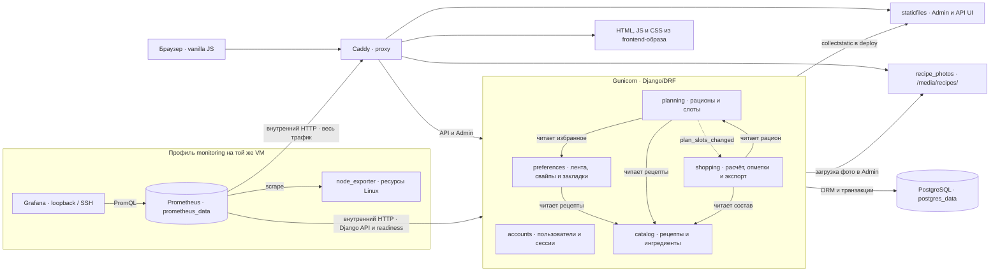
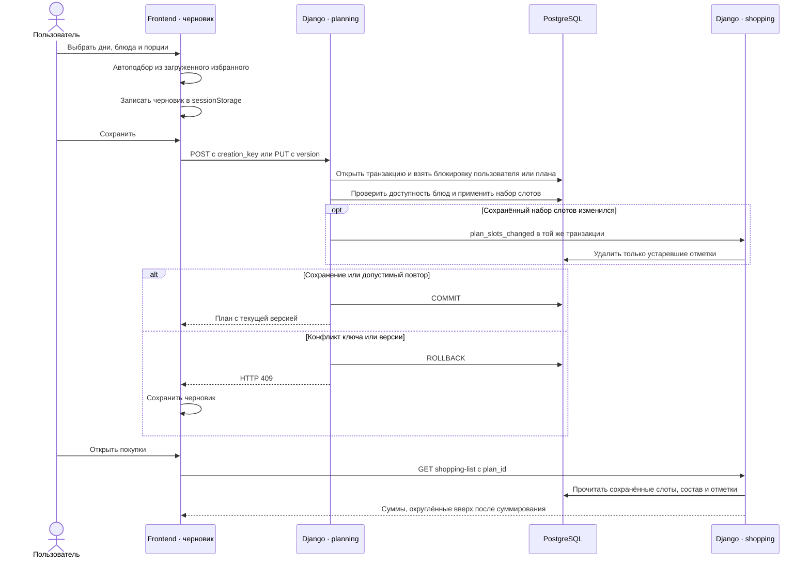

# Архитектура FoodTinder

Production использует один origin. Caddy принимает HTTP или HTTPS, обслуживает
frontend и передаёт `/api/*` и `/admin*` Django. Django Admin использует те же
модели и механизм сессий. PostgreSQL хранит прикладные данные, сессии и временные
счётчики входа и регистрации.

Каждое Django-приложение изменяет принадлежащие ему данные. Shopping обновляет
свои отметки в ответ на сигнал planning. Связи и ограничения описаны в
[ER-диаграмме](data-model.md).

## Сохранение рациона

У нового плана нет прежних отметок. Повтор POST с тем же ключом и содержимым
возвращает первоначальный план. PUT с предыдущей версией допускает повтор только
при совпадении применённого состояния. Подробности в [planning](modules/planning.md)
и [shopping](modules/shopping.md).
