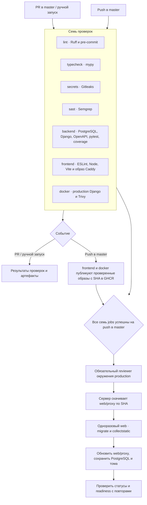

# CI/CD

[Workflow CI](../.github/workflows/ci.yml) запускает семь проверок для PR в
`master`, push в `master` и ручного запуска.

В PR публикуются результаты проверок и артефакты, включая HTML/XML coverage и
отчёты Trivy. Backend выполняет pytest один раз. Production-образы публикуются
с SHA того же коммита только в jobs `frontend` и `docker` на push в `master`.
Блокирующие правила security действуют до публикации соответствующего образа,
а deploy зависит от всех семи jobs. Ручное подтверждение задаётся в GitHub
Environment `production`.

[Инструкция Yandex Cloud](deployment.md) описывает порядок обновления и условия
HTTP-проверки. [Замеры и кеши CI](ci-cd-performance.md) описывают предыдущую
оптимизацию. Еженедельное сканирование production-образа вынесено в
[security.yml](../.github/workflows/security.yml).
