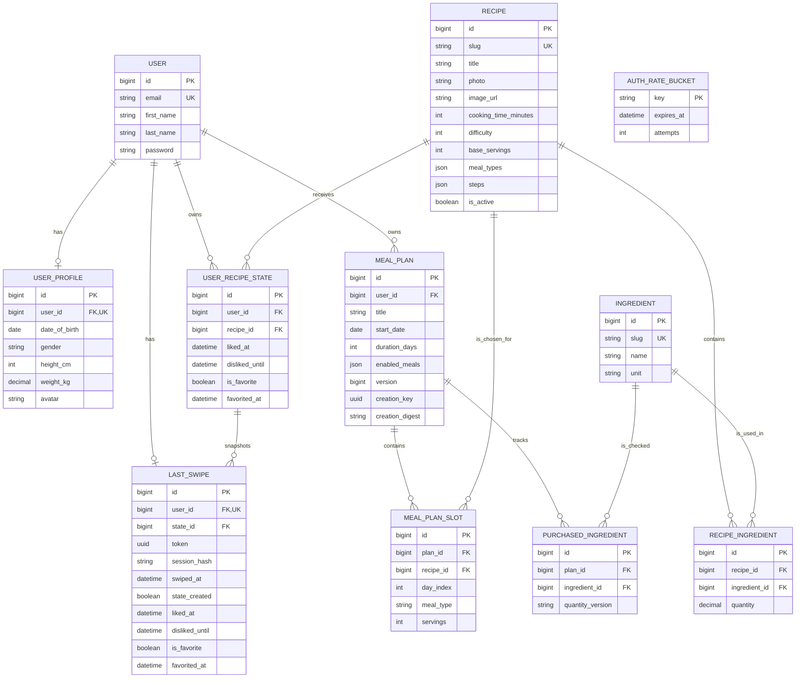

# ER-диаграмма FoodTinder

Диаграмма показывает прикладные Django-модели и основные поля. Django также
управляет таблицами сессий, групп, permissions и журнала Admin.

- `User` требует непустой email и уникальность по `lower(email)`. `UserProfile`
  и `LastSwipe` имеют уникальный FK пользователя. `LastSwipe` хранит состояние
  перед свайпом, связанное с сессией.
- `AuthRateBucket` имеет независимый HMAC-ключ по операции и адресу, индекс по
  `expires_at` и неотрицательный счётчик. Связи с аккаунтами отсутствуют.
- Рецепты и ингредиенты имеют уникальные slug. Postgres проверяет единицы
  `g/ml/pcs`, положительные время, базовые порции и количество, сложность 1–5,
  а также неотрицательность необязательных показателей КБЖУ и цены. Строка
  состава уникальна по `(recipe_id, ingredient_id)`.
- Состояние рецепта уникально по `(user_id, recipe_id)`. Рацион допускает только
  1, 3 или 7 дней. Непустой `creation_key` уникален в пределах пользователя.
- Слот уникален по `(plan_id, day_index, meal_type)`. Индекс дня 0–6, порции 1–20
  и допустимые типы приёмов пищи защищены в БД. Редактор проверяет, что день и
  приём пищи включены в конкретном рационе и рецепт подходит к слоту.
- Отметка уникальна по `(plan_id, ingredient_id)` и действительна для точной
  версии количества. Удаление плана каскадно удаляет слоты и отметки. Рецепты
  в слотах и ингредиенты в составе защищены Django от удаления через `PROTECT`.
